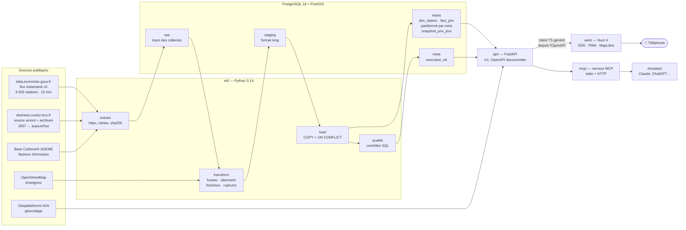

# Carburant

Prix des carburants en France : un pipeline qui les collecte et les historise, une API
publique, un site pensé pour le téléphone, et un serveur MCP pour les assistants.

> **État : Jalon 0 — socle.** Le socle technique est en place et vérifié ; l'ETL,
> l'API et le site ne servent encore aucune donnée réelle. Rien n'est présenté ici
> comme fonctionnel qui ne l'est pas. Avancement détaillé :
> [`docs/avancement.md`](docs/avancement.md).

## Ce que ça fait

Trois questions, trois réponses :

- **« Où est l'essence la moins chère près de moi ? »** — la station la moins chère
  dans un rayon, triée par prix, par distance, ou par **coût réel** (le prix du plein
  plus le carburant brûlé pour y aller).
- **« J'ai 20 km d'autonomie, où faire le plein ? »** — les stations réellement
  atteignables, et l'économie par rapport à la plus proche.
- **« Le gazole a-t-il baissé ce mois-ci dans les Bouches-du-Rhône ? »** — les
  tendances par département, par carburant, autoroute contre route.

Chaque prix est affiché **avec sa date de mise à jour**. Jamais un prix nu.

## Architecture



Le serveur MCP **n'accède jamais à la base** : il appelle l'API publique, comme
n'importe quel client. C'est ce qui permet à quiconque de l'installer.

## Lancer le projet

Il faut Docker, puis :

```bash
cp .env.example .env
```

```bash
make up
```

Le site répond sur <http://localhost:3000>, la documentation de l'API sur
<http://localhost:8000/docs>.

`make aide` liste toutes les commandes. Les principales :

| Commande | Effet |
|---|---|
| `make up` | démarre la pile et applique les migrations |
| `make down` | arrête la pile, garde les volumes |
| `make etl` | lance une collecte complète |
| `make check` | lint, formatage, typage et tests, des deux côtés |
| `make captures` | produit les captures mobiles dans `docs/captures/` |
| `make deploy` | déploie sur le VPS |

## Choix techniques et compromis

Chaque décision est datée et justifiée dans
[`docs/decisions.md`](docs/decisions.md). Les plus structurantes :

- **Le grain de `fact_prix` est le changement de prix**, pas la collecte. Mesuré sur
  l'archive 2025 : 5 297 799 changements dans l'année, soit ≈ 14 500 par jour, contre
  ≈ 5,66 millions de lignes par jour si l'on stockait chaque collecte — **un rapport
  de 390**. Le grain est quasi parfaitement unique dans la source : un seul doublon
  sur 5,3 millions.
- **Les horodatages de la source sont en heure locale de Paris**, servis avec un
  suffixe `+00:00` qui est faux. Les lire en UTC décalerait tous les prix d'une heure
  en hiver et de deux en été. La démonstration est dans
  [`docs/reconnaissance.md`](docs/reconnaissance.md) § 1.4 : sur 5,3 millions
  d'horodatages, les profils horaires de janvier et de juillet se superposent
  (corrélation 0,9987 à décalage nul, 0,18 à une heure).
- **Un prix suspect est conservé, pas rejeté.** Les prix les plus atypiques de France
  sont de vrais prix : L'Île-d'Yeu, Val-d'Isère, Saint-Tropez. Ils sont affichés et
  signalés, mais exclus des classements et des moyennes. Seules les **bornes absolues
  par carburant** rejettent, et elles attrapent les vraies erreurs de saisie.
- **CSS natif, aucune librairie de composants.** Pas de Tailwind avec son thème par
  défaut, pas de Nuxt UI : ce sont les premières sources de l'air « généré ». La CI
  vérifie à chaque exécution qu'aucune n'est entrée dans l'arbre de dépendances.
- **La 3D est en dernière position.** Dès qu'elle menace « trouver une station vite,
  d'une main » ou la performance mobile, c'est elle qu'on allège.

## Documentation

| Fichier | Contenu |
|---|---|
| [`docs/avancement.md`](docs/avancement.md) | jalons, prochaine action, journal |
| [`docs/reconnaissance.md`](docs/reconnaissance.md) | les constats réels sur les sources : champs, volumes, distributions, seuils |
| [`docs/decisions.md`](docs/decisions.md) | une ligne par décision, datée |
| [`docs/a-verifier.md`](docs/a-verifier.md) | ce dont on n'est pas sûr, et qui n'est donc pas publié |
| [`docs/anti-patterns-ia.md`](docs/anti-patterns-ia.md) | 96 signes du design « généré », et ce qu'on fait à la place |
| [`docs/propositions-design.md`](docs/propositions-design.md) | objets 3D et détails « univers carburant », avec leur coût mobile |
| [`docs/comprendre-le-projet.md`](docs/comprendre-le-projet.md) | le projet expliqué simplement, pour un entretien |
| `docs/specs/` | spécifications : données, API et MCP, web, infrastructure |

## Sources et licences

| Source | Licence | Attribution |
|---|---|---|
| Prix des carburants — DGCCRF, via data.economie.gouv.fr | Licence Ouverte 2.0 (Etalab) | ministères économiques et financiers |
| Archives et flux amont — roulez-eco.fr | Licence Ouverte 2.0 | — |
| Facteurs d'émission — Base Carbone® | Licence Ouverte | ADEME |
| Géocodage — Géoplateforme | — | IGN |
| Enseignes — OpenStreetMap | ODbL | © les contributeurs OpenStreetMap |
| Fonds de carte | — | OpenFreeMap · OpenMapTiles · OpenStreetMap |

Le code est publié sous licence MIT.
