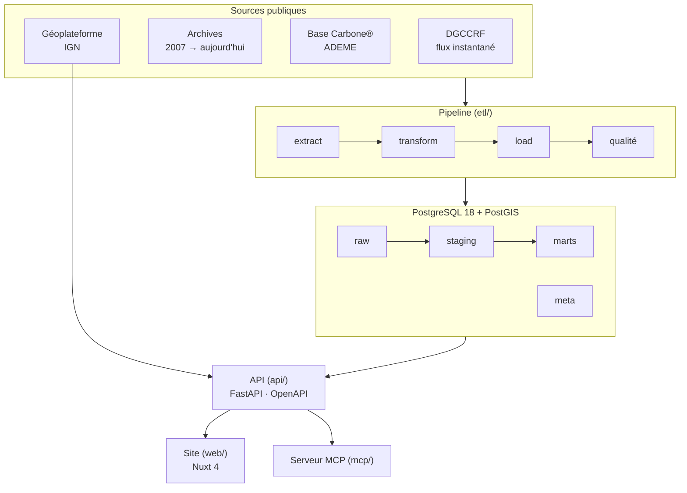

# Comprendre le projet

Ce document sert à présenter Carburant en entretien sans avoir écrit le code. Il est
mis à jour à la fin de chaque jalon. **Tous les chiffres qui y figurent ont été
mesurés** ; ceux qui ne le sont pas encore sont marqués « à mesurer ».

> **État : fin du Jalon 0.** Le socle technique est en place et vérifié. L'ETL, l'API
> et le site ne servent encore aucune donnée réelle. Les sections marquées
> « Jalon N » décrivent ce qui est prévu, pas ce qui tourne.

---

## 1. Le projet en trois phrases

Un pipeline collecte toutes les 15 minutes les prix des carburants des 9 826
stations-service de France, les nettoie et les historise. Une API publique les sert,
avec un calcul de **coût réel** qui répond à la seule question qui compte au volant :
« est-ce que ce détour vaut le coup ? ». Trois surfaces consomment cette API : un site
pensé d'abord pour le téléphone, un serveur MCP qui permet de poser la question à un
assistant, et une documentation OpenAPI.

## 2. Architecture

**Rôle de chaque brique**

| Brique | Ce qu'elle fait | Pourquoi elle est séparée |
|---|---|---|
| `etl/` | télécharge, valide, nettoie, charge, contrôle | elle seule touche à la base en écriture ; elle peut tomber sans que le site tombe |
| `api/` | expose les données, calcule le coût réel | un seul contrat, consommé par tout le reste ; le front et le MCP ne dupliquent aucune logique |
| `web/` | le site, mobile d'abord | il ne parle qu'à l'API, jamais à la base |
| `mcp/` | le serveur MCP | il n'appelle **que l'API publique** : n'importe qui peut l'installer sans rien héberger |
| `infra/` | Docker, migrations, Caddy, sauvegardes | la production se décrit, elle ne s'improvise pas |

## 3. Les concepts clés, en trois phrases chacun

**ETL (extract, transform, load).** Trois étapes séparées : on récupère la donnée
brute, on la met en forme, on la charge. Les séparer permet de rejouer la
transformation sans retélécharger — c'est à ça que sert le schéma `raw`, qui garde
chaque fichier brut avec son empreinte. Chaque étape est une fonction **idempotente** :
la relancer ne crée pas de doublon.

**Modèle en couches `raw` / `staging` / `marts`.** `raw` est la trace de ce qu'on a
reçu, `staging` la version aplatie et validée, `marts` le modèle qu'on sert. Une
erreur dans `marts` se corrige en rejouant depuis `raw`, sans redemander la donnée à
la source. C'est aussi ce qui permet d'expliquer d'où vient un chiffre affiché.

**Partitionnement.** `fact_prix` est découpée en une table physique par mois, sur la
date du changement de prix. Une requête sur le mois courant ne lit qu'une partition, et
supprimer une vieille période revient à détacher une table plutôt qu'à effacer des
millions de lignes. Subtilité mesurée : les bornes de partition sont interprétées en
UTC, donc la première heure de chaque mois en heure de Paris tombe dans la partition
précédente.

**Idempotence.** Relancer une collecte deux fois de suite doit donner exactement le
même état de la base. C'est obtenu par un grain unique — `(station, carburant, date de
changement)` — et un `INSERT … ON CONFLICT DO UPDATE` qui ne met à jour que la date de
dernière observation. Sans cela, un redémarrage malheureux doublerait l'historique.

**PostGIS.** Une extension qui apprend à PostgreSQL ce qu'est un point sur la Terre.
Le type `geography` calcule les distances en mètres sur l'ellipsoïde, et l'index GiST
rend la question « quelles stations à moins de 10 km » quasi instantanée. Mesuré :
**13,7 ms** pour 116 stations dans un rayon de 10 km, avec le dernier prix de chacune.

**Prix « en vigueur » contre prix « modifié ».** C'est la distinction la plus
importante du projet, et la plus facile à rater. Le flux ne publie que les
*changements* de prix : moyenner les prix modifiés un jour donné reviendrait à ne
compter que les stations nerveuses, celles qui bougent souvent. Les agrégats portent
donc sur les prix **en vigueur** — pour chaque station, le dernier changement
antérieur à la fin du jour, s'il a moins de trente jours. Le 15 mars 2007, 879 prix de
gazole ont été modifiés ; 6 050 étaient en vigueur.

**Prix atypique, et pourquoi on ne le supprime pas.** Un prix très éloigné de la
médiane de son département est signalé, mais **conservé et affiché** : ce sont le plus
souvent de vrais prix élevés — L'Île-d'Yeu, Val-d'Isère, Saint-Tropez. Il est
simplement exclu des moyennes et des classements. La règle utilise l'écart absolu
médian (MAD) plutôt que l'écart-type, parce que la MAD n'est pas tirée par les valeurs
extrêmes qu'on cherche justement à détecter.

**Contrôle qualité exécuté, pas relu.** Huit questions sont posées à la base à chaque
collecte — le nombre de stations a-t-il bougé de plus de 10 % ? la partition DEFAULT
est-elle vide ? une date est-elle dans le futur ? Chacune rend un verdict **et une
mesure lisible**. Un échec marque l'exécution, mais ne jette jamais les données
chargées : on garde la donnée et on signale.

**Rapprochement par clé plutôt que par géographie.** Pour attacher une enseigne à une
station, le plan était de chercher le point OpenStreetMap le plus proche. En
interrogeant vraiment OSM, on a trouvé mieux : 80 % de ses stations françaises portent
l'identifiant officiel du flux. Le rapprochement est donc une jointure, et la
géographie ne sert que de filet — 8 stations sur 9 769. Couverture obtenue : **99,4 %**.

**API REST et OpenAPI.** L'API décrit elle-même ses routes, ses paramètres et ses
réponses dans un fichier OpenAPI. Ce fichier n'est pas de la documentation décorative :
le client TypeScript du site **en est généré**, et la CI échoue s'il n'est plus à jour.
Le contrat ne peut donc pas diverger du code.

**SSR (rendu côté serveur).** Les pages de contenu sont rendues en HTML sur le serveur
avant d'être envoyées, puis « hydratées » côté navigateur. Le premier affichage est
donc rapide et indexable par les moteurs de recherche. La carte et la 3D, elles, sont
montées uniquement côté client : elles n'ont aucun intérêt dans le HTML initial.

**PWA (application web progressive).** Un manifeste et un service worker permettent
d'installer le site sur l'écran d'accueil et de garder hors ligne la coquille de
l'application et les dernières fiches consultées. Règle absolue : un prix en cache est
**toujours** affiché avec sa date. Mieux vaut un prix daté d'hier qu'un prix qui ment
sur sa fraîcheur.

**Three.js.** Une bibliothèque qui pilote le GPU depuis le navigateur via WebGL. Elle
sert ici à un seul objet utile — une jauge dont l'aiguille suit l'autonomie saisie — et
non à de la décoration plein écran. Chaque scène est chargée à la demande, ne redessine
rien quand rien ne bouge, et a un repli en image pour les appareils modestes.

**MCP (Model Context Protocol).** Un protocole standard qui permet à un assistant
d'appeler des outils extérieurs. En publiant un serveur MCP, on rend les données du
projet interrogeables en langage naturel depuis Claude, ChatGPT ou un autre client,
sans que ces clients sachent quoi que ce soit du projet. Le serveur n'expose que des
outils en lecture, et n'accède qu'à l'API publique.

## 4. Choix techniques et compromis

| Choix | Pourquoi | Ce qu'on perd |
|---|---|---|
| **Grain = changement de prix** | ≈ 14 500 lignes par jour au lieu de ≈ 5,66 millions, soit un rapport de **390** | les moyennes demandent un calcul à part, sur les prix **en vigueur** : moyenner les seuls prix modifiés un jour donné biaiserait vers les stations qui changent souvent |
| **SQL brut / SQLAlchemy Core, pas d'ORM** | les requêtes géographiques et les agrégats s'écrivent mieux en SQL ; on voit ce qui part à la base | pas de mapping objet automatique, il faut écrire les requêtes |
| **CSS natif, zéro librairie de composants** | c'est la première source de l'air « généré par IA » ; et le poids JS reste maîtrisé (**77,7 Ko gzip** pour tout le site) | tout composant est à dessiner, donc plus lent à écrire |
| **Le MCP appelle l'API, jamais la base** | n'importe qui peut l'installer ; la base n'est jamais exposée | un appel réseau de plus, donc un peu de latence |
| **Cron d'abord, Prefect plus tard** | un cron dans un conteneur suffit à 96 collectes par jour ; Prefect serait de l'orchestration pour l'orchestration | pas d'interface de supervision tant qu'on n'a pas migré |
| **Python 3.14, Node 26, TypeScript 6.0** | les dernières versions **supportées par toutes les dépendances**, vérifiées une par une | pas les toutes dernières : le SDK MCP plafonne à 3.14, `typescript-eslint` à TypeScript < 6.1 |

## 5. Les chiffres réels du projet

Mesurés le 23/11/2026. Les cases vides seront remplies au jalon indiqué.

| Mesure | Valeur | Comment elle a été obtenue |
|---|---|---|
| Stations dans le flux | **9 826** | export complet du flux v2 |
| Dont sur autoroute | **435** (4,4 %) | champ `pop = 'A'` |
| Carburants publiés | **6** | Gazole, SP95, SP95-E10, SP98, E85, GPLc |
| Changements de prix en 2025 | **5 297 799** (≈ 14 500/jour) | archive annuelle, comptage en streaming |
| Doublons du grain sur 5,3 M de lignes | **1** | unicité `(station, carburant, maj)` |
| Volume en base, 1 an | **307 Mo de données + 232 Mo d'index** | chargement réel dans PostgreSQL 18.7 |
| Volume projeté, 2007 → aujourd'hui | **≈ 64 M de lignes, ≈ 6,5 Go** | extrapolation à partir du comptage réel de 16 années |
| Durée du `COPY` de 5,3 M de lignes | **14,0 s** | `\timing` dans psql |
| Requête « stations proches » | **13,7 ms** | `EXPLAIN ANALYZE`, 10 km autour du Prado, 14 partitions |
| JS client, tout le site | **77,7 Ko gzip** | sortie de build Nuxt, mesurée fichier par fichier |
| Tests | **172 Python + 109 front = 281** | `make check`, au 24/11/2026 |
| Stations chargées en base | **9 825** | `etl run` sur le flux réel |
| Changements de prix chargés | **33 153** | une collecte, grain « un changement de prix » |
| Ruptures de stock chargées | **22 186** | carburant annoncé mais sans prix |
| Prix rejetés à la validation | **5** | tous des E85 à 1,99 €, erreurs de saisie |
| Idempotence | **0 prix inséré, 33 153 déjà connus** | deuxième exécution de suite sur les mêmes données |
| Partitions créées | **15** | juillet 2025 → décembre 2026, partition DEFAULT vide |
| `/v1/stations/proches`, p95 | **18,7 ms** | 200 requêtes dans dix villes de France (médiane 10,4 ms, max 65,5 ms) |
| Couverture des enseignes | **99,4 %** | 9 761 par identifiant officiel OSM, 8 par géographie, 59 sans |
| Part de prix atypiques signalés | **1,21 %** | sur 25 359 prix frais, fourchette attendue 0,4 à 2,5 % |
| Poids réel d'une ligne d'historique | **120,2 octets** | mesuré sur 5,9 M de lignes (431 Mo de données + 245 Mo d'index) |
| Durée d'amorçage | **≈ 45 s par million de lignes** | parsing XML compris, mesuré sur l'archive 2022 |
| Agrégats journaliers | **86 392 lignes pour 365 jours**, en 34 s | année 2007 complète, calcul en une passe |
| Durée de l'amorçage complet de l'historique | à mesurer (Jalon 2) | |
| Scores Lighthouse mobile | à mesurer (Jalon 5) | |
| Taux de couverture des enseignes OSM | à mesurer (Jalon 2) | |

## 6. Ce qui a été découvert en regardant les vraies données

Ce sont les trois histoires les plus intéressantes à raconter en entretien, parce
qu'elles montrent la différence entre lire une documentation et vérifier.

**Le fuseau horaire qui ment.** Le portail sert les dates de mise à jour avec un
suffixe `+00:00`. Elles ne sont pas en UTC : ce sont des heures locales de Paris. Les
croire aurait décalé tous les prix d'une heure en hiver et de deux en été, sans
qu'aucun test ne proteste. La preuve tient en une mesure : sur les 5,3 millions
d'horodatages de 2025, la distribution horaire de janvier (UTC+1) et celle de juillet
(UTC+2) **se superposent** — corrélation 0,9987 à décalage nul, contre 0,18 à une heure
de décalage. Si le champ était en UTC, juillet serait décalé. Il ne l'est pas. Un
contrôle qualité vérifie désormais `max(maj) <= now()` à chaque exécution, pour que
l'hypothèse ne puisse pas casser en silence.

**La règle de détection d'anomalies qui signalait 19 % des prix.** La spécification
prévoyait de signaler un prix s'écartant de plus de k écarts absolus médians (MAD) de
la médiane de son département. Appliquée telle quelle : jusqu'à 19,3 % des prix de SP95
signalés. La cause est intéressante — dans un département où beaucoup de stations
affichent le même prix, la MAD descend à **0,0005 €**, et un prix parfaitement normal se
retrouve à 120 MAD de la médiane. Un plancher de MAD à 0,05 € ramène le taux à 0,4–2,5 %.
Et en regardant ce que la règle attrape alors, deuxième surprise : L'Île-d'Yeu,
Val-d'Isère, Saint-Tropez — **de vrais prix**, élevés parce que la station est sur une
île ou en station de ski. D'où la règle finale : un prix suspect est conservé et
affiché, simplement exclu des classements.

**La transaction qui annulait le journal.** `/v1/meta` affirmait qu'aucune collecte
n'avait jamais réussi, alors que les données étaient bien en base. En mode non
autocommit, psycopg ouvre une transaction dès le **premier ordre**, y compris un simple
`SELECT`. Un contrôle de la partition DEFAULT, placé entre le chargement et la clôture
de l'exécution, transformait donc les blocs suivants en simples points de reprise, et
la fermeture de la connexion annulait la clôture. Corrigé en `autocommit=True` avec des
transactions explicites, et verrouillé par un test de non-régression. C'est le genre de
bogue qu'aucune relecture ne trouve : il fallait regarder ce que l'API racontait.

**La politique de sécurité qui éteignait le site.** Une CSP `script-src 'self'` posée
par le reverse proxy bloque les deux scripts **en ligne** que Nuxt émet dans chaque page
(sa carte d'import et sa configuration publique). Résultat : la page s'affiche
parfaitement — elle est rendue côté serveur — mais plus rien ne répond, aucun bouton,
aucune suggestion d'adresse. Le site pose désormais sa propre politique avec un nonce
par requête, et un test Playwright surveille la console pendant tout le parcours, parce
qu'aucune autre assertion ne voit la différence tant qu'on ne touche pas aux boutons.

**L'audit qui a trouvé une fenêtre de trente et un jours.** À la fin du Jalon 2, un
relecteur indépendant — qui n'avait pas écrit le pipeline — a recalculé les agrégats
par ses propres requêtes. Verdict : aucun prix faux, aucune date fausse, aucun
doublon. Mais deux chemins de calcul coexistaient, l'un accordant trente jours de
validité à un prix, l'autre trente et un. Le même jour recalculé par l'autre chemin
changeait de valeur — 23 prix de gazole d'écart sur le seul 15 mars 2007. Le test
censé verrouiller ce point avait d'abord été écrit faux : il prenait une date à
vingt-neuf jours de la cible et passait donc tranquillement avec le bug en place. Un
test qui n'échoue pas contre le code fautif ne prouve rien — on le vérifie en remettant
le bug.

**Le seuil de fraîcheur qui aurait écarté un prix sur cinq.** La date de mise à jour
est celle du dernier *changement* de prix, pas du dernier contrôle. Une station qui ne
bouge pas ses prix pendant dix jours n'est pas pour autant fausse. Exclure les prix de
plus de 7 jours, comme prévu initialement, aurait retiré 18 % des prix et 40 % du GPLc —
c'est-à-dire des stations qui existent et qui vendent au prix affiché.

## 7. Vingt questions qu'un recruteur peut poser

**Données et pipeline**

1. *Pourquoi collecter toutes les 15 minutes ?* Parce que c'est le rythme auquel
   data.economie moissonne la source amont ; plus souvent, on ne récupère rien de neuf.
   La source amont, elle, se met à jour toutes les 10 minutes et sert de repli.
2. *Comment garantissez-vous qu'une relance ne duplique pas les données ?* Par un grain
   unique `(station, carburant, date de changement)` et un `ON CONFLICT DO UPDATE` qui
   ne touche que la date de dernière observation. Le test d'idempotence relance l'ETL
   deux fois et compare les comptes.
3. *Pourquoi partitionner, avec seulement 64 millions de lignes ?* Moins pour la
   performance de lecture que pour l'exploitation : créer et détacher des partitions
   est instantané, là où supprimer des millions de lignes bloque la table. Et la clé de
   partition doit figurer dans la contrainte d'unicité, d'où le choix de partitionner
   sur la date de changement et non sur la date de collecte.
4. *Que se passe-t-il si la source change de format ?* La validation pydantic à la
   frontière `raw → staging` compte les erreurs par champ, et les contrôles qualité
   font échouer l'exécution si le nombre de stations s'écarte de plus de 10 % de la
   moyenne des sept derniers jours. On le sait donc dans les 15 minutes.
5. *Comment distinguez-vous un prix faux d'un prix simplement élevé ?* Deux mécanismes
   distincts : des bornes absolues par carburant rejettent l'impossible (un E85 à
   1,99 €, qui est un prix de SP95 saisi dans la mauvaise case), et un écart à la
   médiane départementale signale l'atypique sans le rejeter.
6. *Pourquoi conserver un prix suspect ?* Parce que les prix les plus atypiques de
   France sont vrais. Les rejeter ferait disparaître les stations d'île et de montagne,
   qui sont précisément celles où connaître le prix a le plus de valeur.
7. *Combien pèse l'historique complet, et pourquoi le charger entier ?* ≈ 6,5 Go pour
   64 millions de lignes, mesuré. Le charger entier coûte moins d'une demi-heure et
   permet des réponses comme « le jour de la semaine historiquement le moins cher » sur
   19 ans, ce que des agrégats dégradés ne permettraient pas.
8. *Qu'est-ce que vous ne pouvez pas faire avec ces données ?* Nommer les stations : le
   flux officiel ne contient ni nom ni enseigne. On les rapproche d'OpenStreetMap, avec
   un score et un taux de couverture affiché. Et il n'y a aucune station d'outre-mer
   dans le flux.

**API et modélisation**

9. *Comment calculez-vous le coût réel ?* `prix × litres + prix × (2 × distance ×
   consommation / 100)`. L'hypothèse — aller-retour depuis la position, carburant du
   trajet valorisé au prix de la station — est documentée et affichée, parce qu'elle est
   discutable.
10. *Pourquoi un facteur de détour de 1,3 ?* C'est une valeur de départ, pas une
    mesure : la distance routière vaut environ 1,3 fois la distance à vol d'oiseau.
    Elle est marquée « à calibrer » dans `docs/a-verifier.md`, et le sera en
    échantillonnant de vrais itinéraires.
11. *Comment la fonction de coût est-elle testée ?* Trois niveaux : tests unitaires sur
    la fonction pure, tests de propriétés avec `hypothesis` (le coût croît avec la
    distance, l'économie est toujours positive ou nulle, une station hors autonomie
    n'est jamais recommandée), et un test d'intégration PostGIS sur un jeu de stations
    synthétiques autour du Prado.
12. *Pourquoi générer le client TypeScript depuis l'OpenAPI ?* Pour que le contrat ne
    puisse pas diverger : si une route change et que le client n'est pas régénéré, la
    CI échoue. C'est moins de code à écrire et une source d'erreur en moins.
13. *Comment gérez-vous un lieu ambigu comme « le Prado » ?* Par une règle chiffrée,
    dérivée de vraies requêtes : on renvoie les candidats au lieu de choisir si le
    meilleur score est sous 0,80 ou si l'écart avec le second est sous 0,05. L'avenue du
    Prado existe dans deux arrondissements, à 1,2 km l'une de l'autre, avec des scores
    qui diffèrent de 0,009 : il n'y a objectivement rien à deviner.
14. *Que renvoie l'API si aucune station n'est atteignable ?* La plus proche, avec un
    avertissement explicite. C'est l'un des sept cas limites testés, avec l'autonomie
    nulle, le carburant absent de la zone, la position hors de France et les égalités.

**Front et accessibilité**

15. *Pourquoi pas de framework CSS ?* Parce qu'un thème par défaut se reconnaît
    immédiatement, et que le site doit avoir l'air fait à la main. Le coût est réel —
    chaque composant est à dessiner — mais le résultat est maîtrisé : 77,7 Ko de JS pour
    tout le site, et une CI qui vérifie qu'aucune librairie de composants n'entre dans
    l'arbre de dépendances.
16. *Comment savez-vous que les contrastes sont bons ?* Ils sont calculés, pas estimés :
    un test lit la feuille de tokens et vérifie chaque paire réellement utilisée, dans
    les deux thèmes. C'est ce test qui a détecté qu'une couleur de texte reprenait par
    erreur une teinte de bordure, à 3,4:1 au lieu de 4,5:1.
17. *Comment la couleur des carburants reste-t-elle lisible pour un daltonien ?* Elle
    n'est jamais seule : la pastille reprend la forme de l'étiquette européenne
    EN 16942 — cercle pour les essences, carré pour le gazole, losange pour le GPL — et
    le libellé est toujours présent. En thème clair, les six teintes ont en plus une
    luminance volontairement étalée, de 4,6:1 à 9,5:1.
18. *Pourquoi la carte n'est-elle pas sur la page d'accueil ?* Parce que MapLibre est
    lourd et que la liste des stations répond à la question sans elle. La carte se
    charge à l'ouverture de la page carte, pas avant.

**Production**

19. *Comment savez-vous que la collecte tourne ?* Par un « dead man's switch » : l'ETL
    envoie un signal après chaque exécution réussie, et c'est **l'absence** de signal qui
    déclenche l'alerte. Un mail envoyé par le serveur lui-même ne partirait pas si le
    serveur tombait.
20. *Qu'est-ce qui vous a le plus surpris ?* Que la documentation d'une source
    officielle puisse être vraie et la donnée fausse en même temps : le champ de date
    est bien un horodatage, mais le fuseau annoncé n'est pas le bon. Depuis, je ne code
    plus contre une API sans avoir regardé ce qu'elle renvoie vraiment.
